# KubeTower

**A Kubernetes console you run yourself, on your desktop or inside a cluster: one binary, AGPL-3.0-only.**

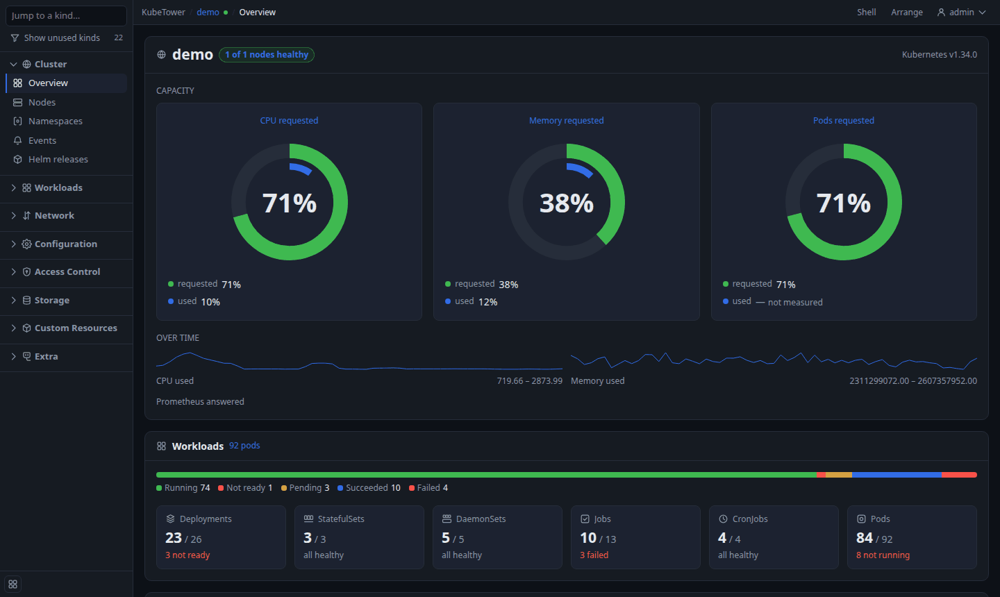

- **One binary, two profiles.** A desktop window on the clusters in your kubeconfig, or a shared console in a cluster behind single sign-on (`--incluster`).
- **Your RBAC, enforced.** In a cluster, every read and every action is checked against the signed-in person's own permissions and recorded in an audit log.
- **Safe by construction.** The Go backend is the only Kubernetes client; no credential ever reaches the browser. Every write shows a dry run first.
- **Everything in one place.** Every kind including custom resources, logs, shells, port-forwards, metrics, Helm releases, multi-cluster.
- **No telemetry.** The only call the desktop makes on its own is a check for a newer release (`KT_UPDATE_CHECK=off` turns it off).

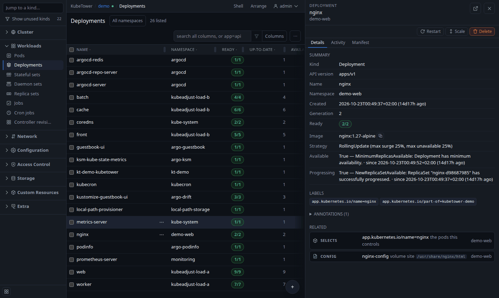

## Extras

Optional pages for what only some clusters run. All are **off by default** and turned on per cluster in **Settings > Extra** (details in [`docs/EXTRAS.md`](docs/EXTRAS.md) and [`docs/EXTRAS-IN-A-CLUSTER.md`](docs/EXTRAS-IN-A-CLUSTER.md)).

| | Extra | What it adds |
|---|---|---|
| 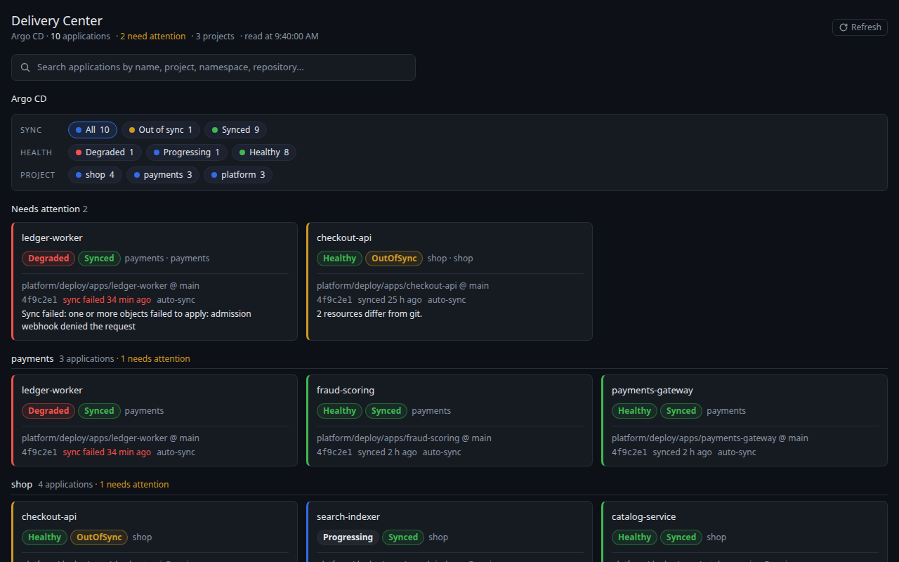 | **Argo CD (Delivery Center)** | Argo CD Applications and Flux CD Kustomizations and HelmReleases: sync, health, history. |
| 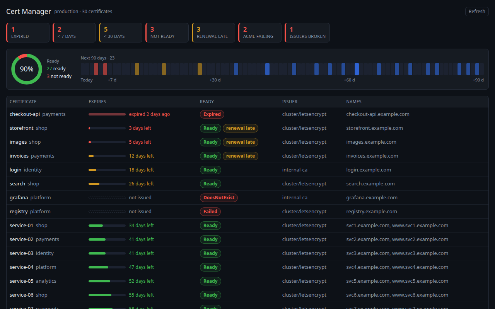 | **Cert Manager** | What expires soon, failing ACME orders and challenges, broken issuers. Read-only. |
| 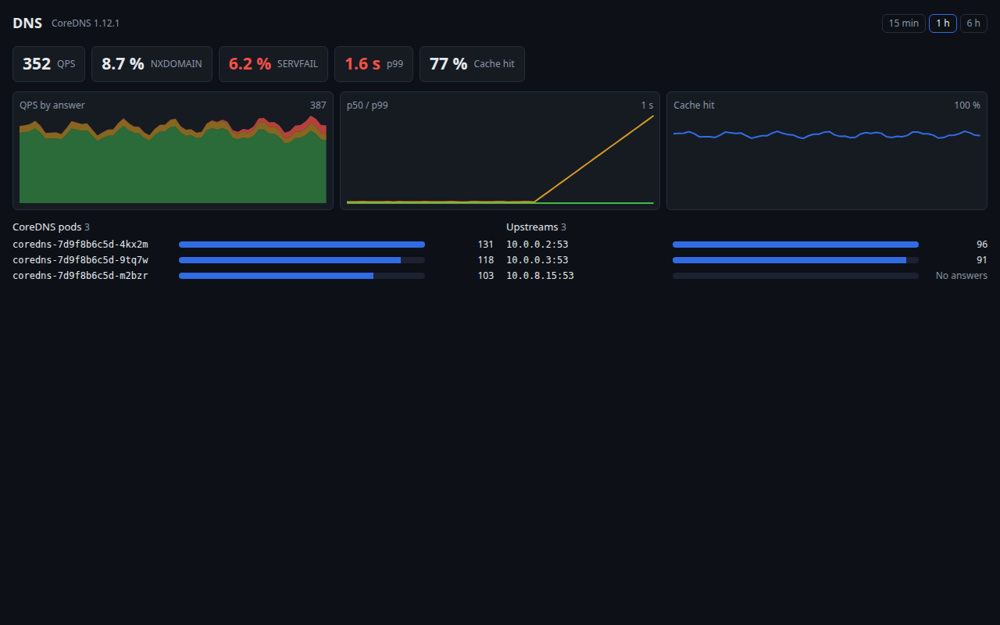 | **DNS** | CoreDNS health from Prometheus: queries, NXDOMAIN and SERVFAIL share, latency, cache hits, per pod and per upstream. Read-only. |
| 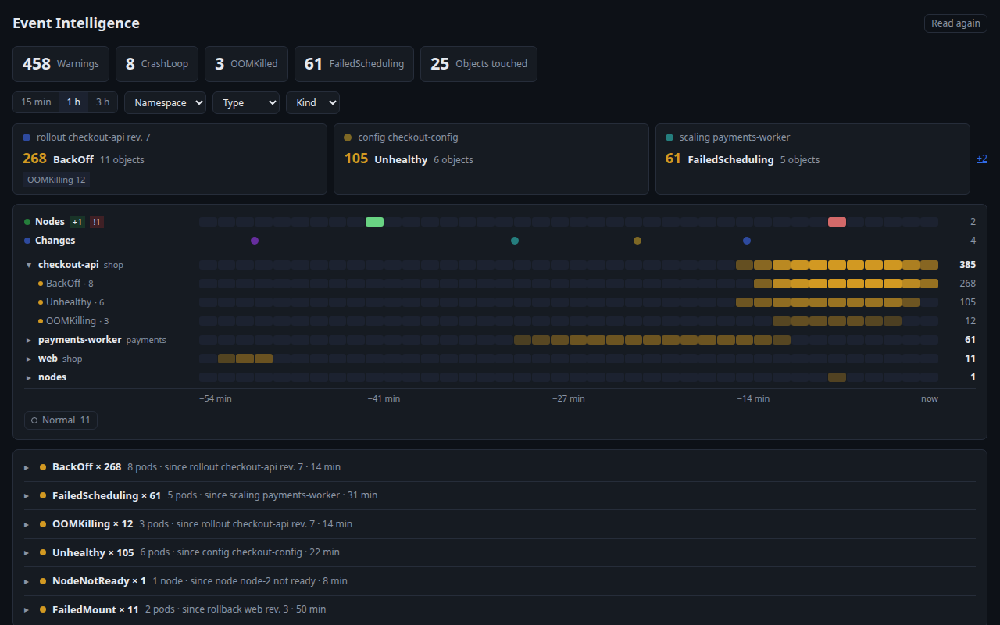 | **Event Intelligence** | Kubernetes Events deduplicated and grouped by cause, on a timeline under what changed just before: rollouts, ConfigMap edits, scaling, nodes. Read-only. |
| 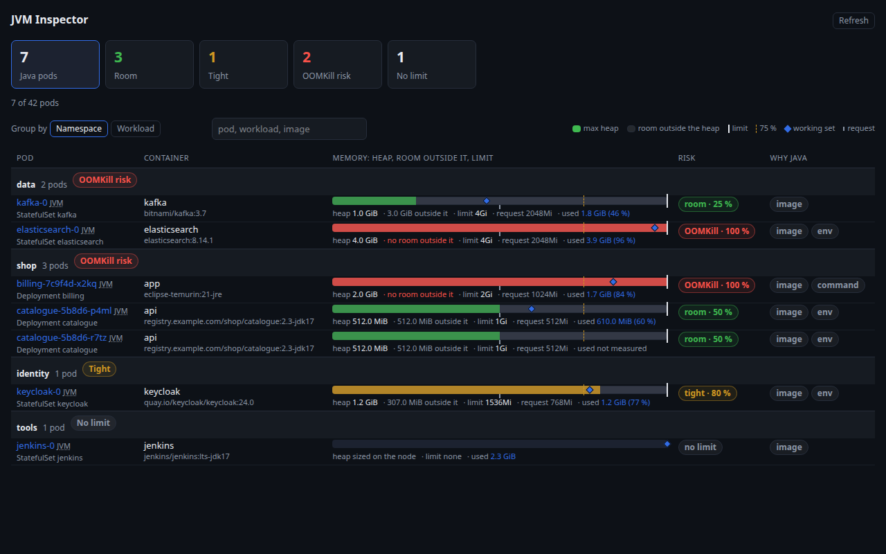 | **Runtime Inspector** | Which pods run Java and how close the heap is to the memory limit; on demand, GC, flags and thread dump. |
| 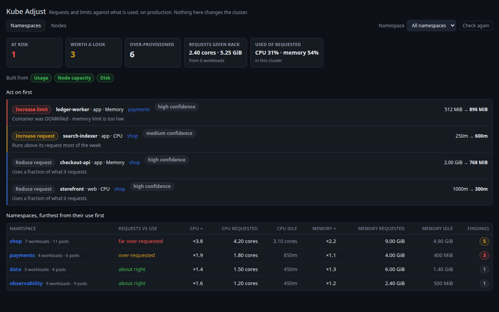 | **KubeAdjust** | Right-sizing: do requests and limits fit real usage? Copy-only `kubectl` fixes. |
| 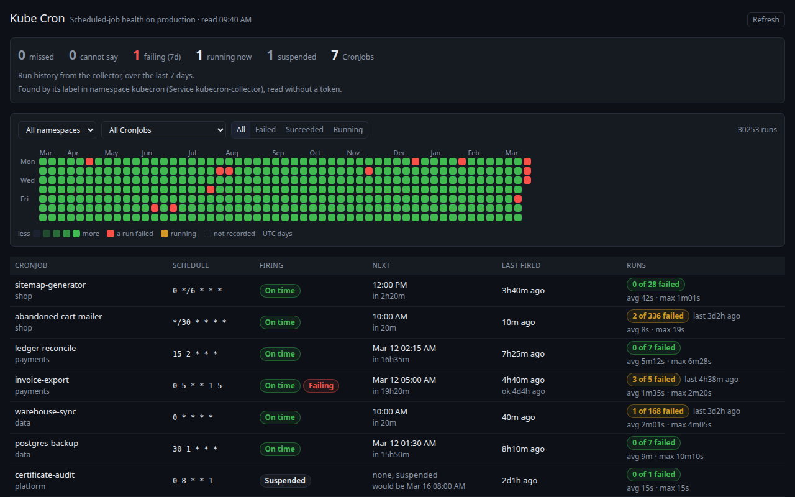 | **KubeCron** | Does each CronJob run when it should, and what did its past runs do. |
| 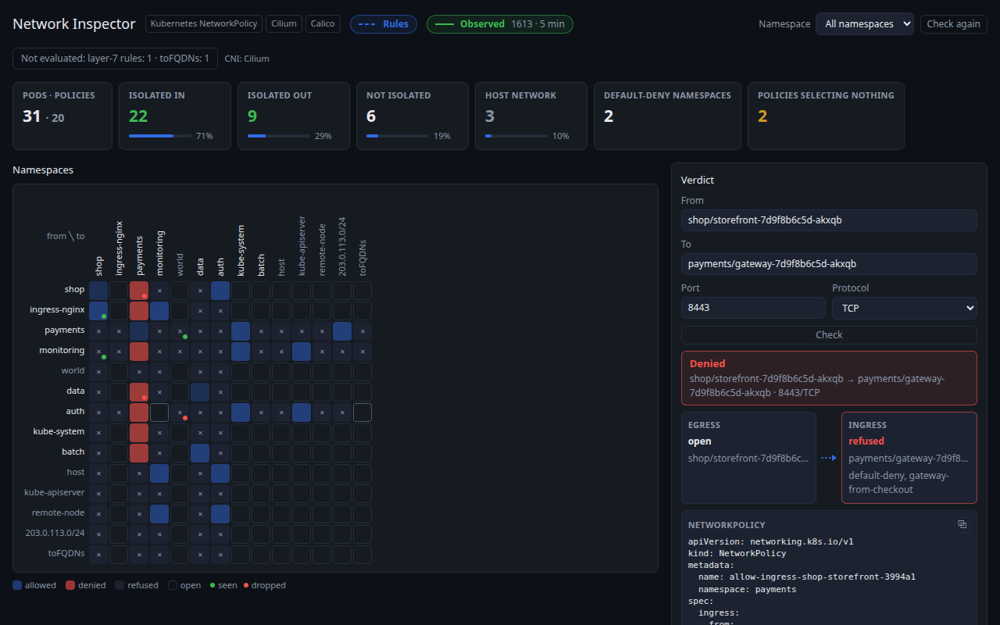 | **Network Inspector** | Which NetworkPolicies select a pod, and whether one pod would reach another. Reads rules, never traffic. |
| 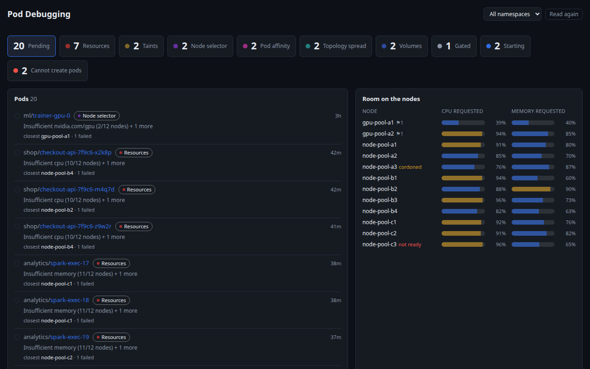 | **Pod Debugging** | Why a pod waits: resources, taints, selectors, volumes, quota, and the closest node. |
| 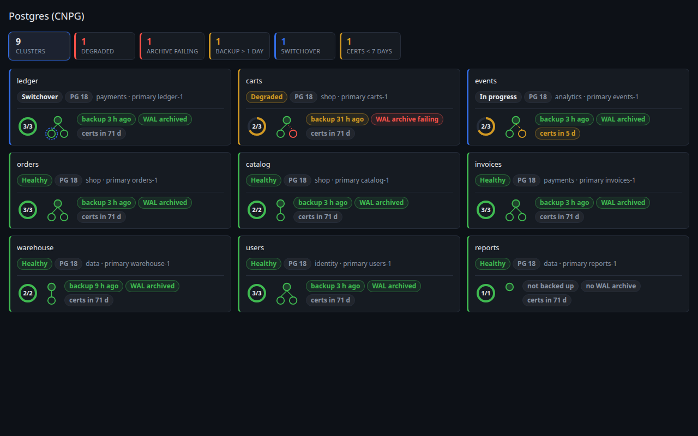 | **Postgres (CNPG)** | CloudNativePG clusters at a glance: primary, replicas, failovers, backups, certificates; its statistics and tables, read-only. |
| 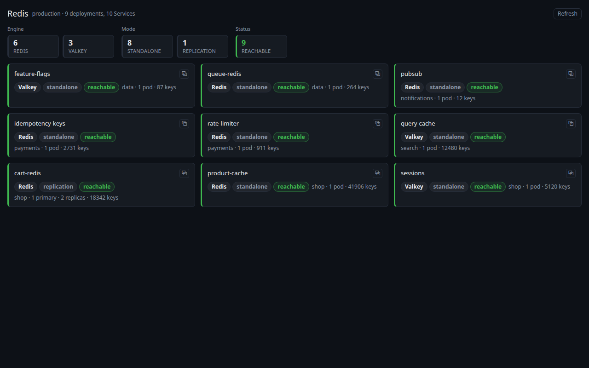 | **Redis viewer** | Keys, values and memory of Redis and Valkey, read-only, through a reviewed port-forward. |
| 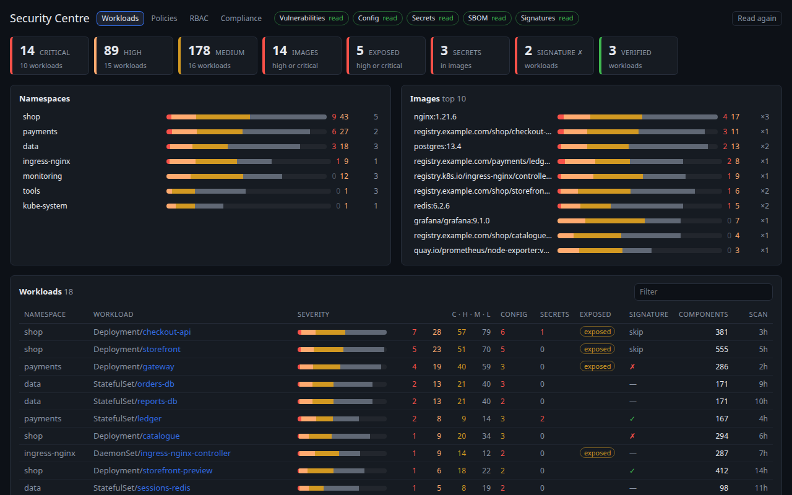 | **Security Center** | Trivy Operator findings by severity, per workload and pod. |

**Planned:** a general Database viewer (MySQL, MariaDB, MongoDB), on the model of the Redis viewer.

## Install

Download from the [Releases](https://github.com/thonicdev/kubetower/releases) page:

| System | File |
|---|---|
| Windows | `kubetower-<version>-setup.exe` or `kubetower-<version>-win-x64.zip` |
| macOS | `kubetower-<version>-arm64.dmg` (Apple silicon) or `-x64.dmg` (Intel) |
| Linux | `.deb`, `.rpm`, `.AppImage` or `.tar.gz` |
| Kubernetes | image `ghcr.io/thonicdev/kubetower:<version>` through the [Helm chart](https://github.com/thonicdev/kubetower-helm-charts) |

Every file is listed in `checksums.txt`, signed with the project's Ed25519 key (`checksums.txt.sig`); see [`docs/INSTALL.md`](docs/INSTALL.md) for details and how to [check a download](docs/INSTALL.md#check-a-download) with OpenSSL.

The desktop then updates itself from **Settings**: Download, verified against that signature, then Restart to update ([Updating](docs/INSTALL.md#updating)).

### Unsigned builds

> **The Windows and macOS builds are not code-signed yet.** Both systems warn before the first run, and that is expected. Check your download against `checksums.txt` first. Each release's notes open with the same notice ([`packaging/release-notes/unsigned.md`](packaging/release-notes/unsigned.md)).

| System | What you will see | What to do |
|---|---|---|
| Windows, SmartScreen | "Windows protected your PC", *Unknown publisher* | **More info**, then **Run anyway** (or **Unblock** in the file's Properties; for the zip, unblock it before extracting) |
| Windows 11, Smart App Control on | Blocked, with no override | No bypass for the program; run the console in a cluster through the Helm chart instead. Turning Smart App Control off works but **usually cannot be undone without reinstalling Windows** |
| macOS, Gatekeeper | "KubeTower" cannot be opened | **System Settings > Privacy & Security > Open Anyway**, or `xattr -dr com.apple.quarantine /Applications/KubeTower.app` |
| Linux | Nothing, except `dnf` noting the `.rpm` is not signed | Check against `checksums.txt` |

## Quick start

- **Desktop:** start KubeTower from your applications menu (or run `kubetower --app`). It reads `KUBECONFIG` or `~/.kube/config` and opens a window on `http://127.0.0.1:5823`, loopback only. Settings are `KT_` environment variables, listed in [`.env.example`](.env.example).
- **In a cluster:** install the [Helm chart](https://github.com/thonicdev/kubetower-helm-charts) with your OIDC issuer; people then see and do only what their own RoleBindings allow. The in-cluster console does not create, change or delete RBAC objects in this version. See the [chart's README](https://github.com/thonicdev/kubetower-helm-charts#readme) and the [threat model](docs/SERVER-MODE-THREAT-MODEL.md).

## Build

```bash
cd web && corepack pnpm install --frozen-lockfile && corepack pnpm build && cd ..
go run ./cmd/ktbuild -o ./kubetower
```

Needs the Go version pinned in [`go.mod`](go.mod), Node and pnpm. The development loop is in [`docs/DEVELOPMENT.md`](docs/DEVELOPMENT.md).

## Contributing

Issues and pull requests are welcome, from anyone, with nothing to sign: see [`CONTRIBUTING.md`](CONTRIBUTING.md). To report a vulnerability, follow [`SECURITY.md`](SECURITY.md): privately, through GitHub's **Report a vulnerability**, never in an issue.

## License

**GNU AGPL-3.0-only** for the whole product, extras included: see [`LICENSE`](LICENSE). [`LICENSING.md`](LICENSING.md) explains the network clause and that the name is not licensed: a fork must rename the result.

Copyright (C) 2026 The KubeTower Authors
