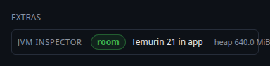
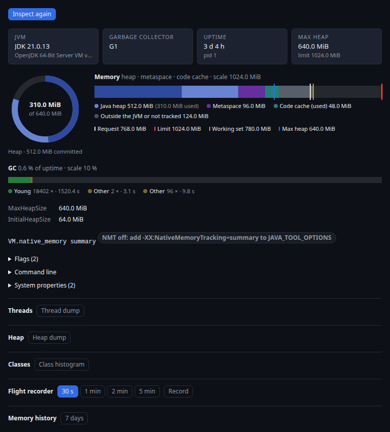
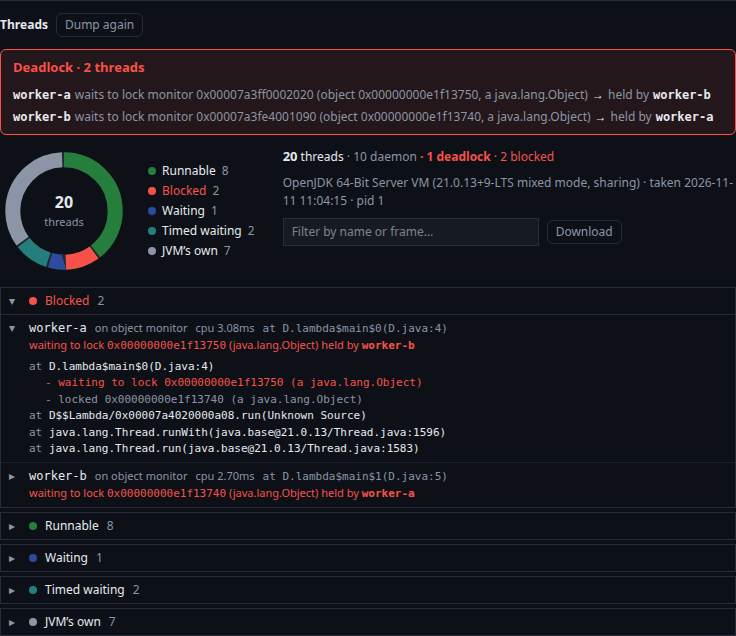
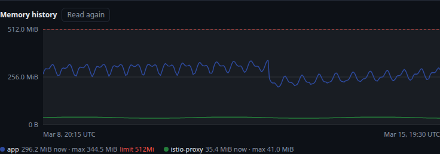
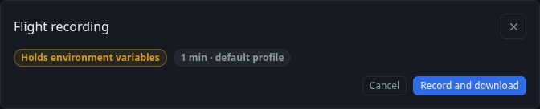
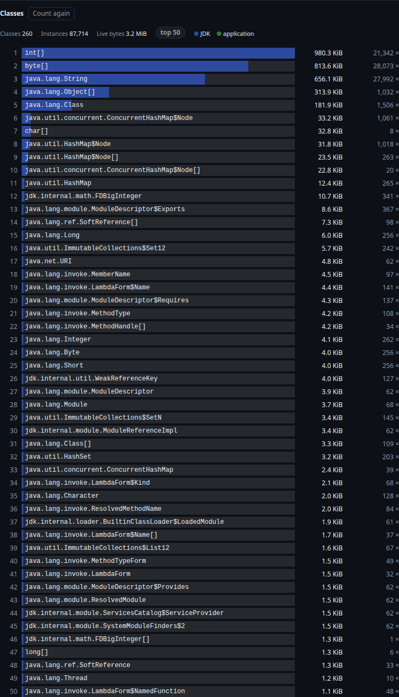
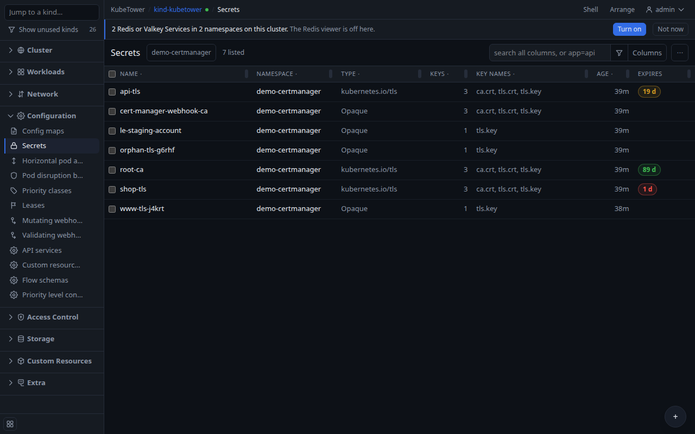
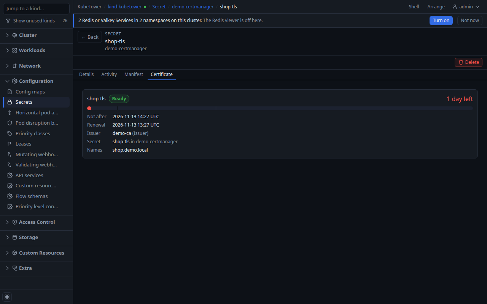

# Extras

The [README](../README.md#extras) lists the extras. This page says how they are
turned on, on each profile, and what three of them do in detail.

Some pages are **extras**: features many clusters have no use for, because each
reads something only some clusters run. They are part of the console, built from
this repository and under the same license as every other page.

| Key | In the menu | What it adds | What the cluster must run for it to say much |
|---|---|---|---|
| `argocd` | Delivery Center | Argo CD Applications and Flux CD Kustomizations and HelmReleases: sync, health, history, and what is being deleted | Argo CD or Flux CD |
| `kubecron` | KubeCron | Whether each CronJob runs when it should, and what its past runs did | Nothing for the verdicts; a KubeCron collector for run history, found by itself (the Service labeled `kubecron.io/collector=true`, its token in `kubecron-api` beside it) or set per cluster in Settings › Extra |
| `kubeadjust` | KubeAdjust | Whether each workload's requests and limits are the right size, and the `kubectl set resources` commands that would fix them | metrics-server; a Prometheus for a seven-day window; the `nodes/proxy` permission for disk figures |
| `redis` | Redis viewer | The keys, values and memory of the Redis and Valkey instances the cluster runs, found from their Services. **It never writes**: every command it can send is a read on a fixed list, refused before it leaves otherwise. Each look opens one port-forward, reviewed for you, and closes it. An instance with a password is opened with the one its own pod is started with, read through the console's reveal - so you need `get` on that Secret - and never shown, stored or put in an address | A Redis or Valkey Service |
| `runtime` (formerly `jvm`, still accepted) | — (Runtime Inspector, from the panel) | Which pods probably run Java, Go, Node.js or Python ([how](#how-the-runtime-inspector-reads-a-runtime)); for Java, recognized from its spec alone - the image (a Java runtime image, a `-jre` or `-jdk` tag, a known Java product such as Kafka or Keycloak), a command line that starts `java` or carries JVM options, or `JAVA_TOOL_OPTIONS`, `JDK_JAVA_OPTIONS` or `JAVA_HOME` in the environment - and, for each Java container, its estimated maximum heap and how close that comes to its memory limit: a warning above 75 % of the limit, an error when an explicit `-Xmx` reaches it. The 75 % line is a heuristic, not a JDK rule. The page counts the Java pods by risk in tiles that filter, draws each container's heap, the room outside it, its limit and the 75 % line on one bar, with the working set from metrics-server as a mark where it is measured, and groups by namespace or by workload; a "Runtime" column on the Pods, Deployments, StatefulSets, DaemonSets, ReplicaSets and Jobs lists carries the worst grade. It reads the spec only: an image whose entrypoint starts Java with nothing in the spec is not recognized. On a Java pod, a tile on its Details and a **JVM tab** ask the JVM itself, on a click: see [below](#the-runtime-inspectors-jvm-tab). A Go container's tab reads pprof ([Go tab](#the-runtime-inspectors-go-tab)), a Node.js container's opens its inspector ([Node.js tab](#the-runtime-inspectors-nodejs-tab)) | Pods running a JVM, Go or Node.js |
| `events` | Event Intelligence | Kubernetes Events made readable: repeats counted once per object (`BackOff × 214`), grouped by cause across objects and unfolded per object, set on a timeline under what changed just before - a rollout with its revision, a ConfigMap edit, scaling, a new or failing node - with tiles that filter (warnings, crash loops, OOM kills, scheduling failures, objects touched), a 15 min, 1 h or 3 h window, and filters by namespace, type and kind. **It reads only, and says "since", never "because"**: a change is shown ahead of the groups that began after it. On a Pod, Deployment, StatefulSet, DaemonSet, ReplicaSet or Job, the **Activity tab** draws the same timeline and causes narrowed to the object and its pods, in place of the core's plain list of events (its changes and rollouts stay below). A ConfigMap's data and Secrets are never read | Nothing; `list replicasets`, `configmaps`, `pods` and `nodes` for the changes (a refused read is said, and the rest still shows) |
| `netinspect` | Network Inspector | Which NetworkPolicies select each pod, which peers and ports their rules allow, and whether one pod would reach another, with the policy and rule that decide on each side. **It reads the rules, never traffic**: every edge it draws is dashed and says so | NetworkPolicies, and a network plugin that applies them (flannel alone does not, and the page says so) |
| `pending` | — (Pod Debugging, from the panel) | Why each Pending pod waits - resources, taints, node selector, pod affinity, topology spread, volumes, a quota that refused its creation - which node comes closest on what can be computed from the specs, and what it would take to start it. It never writes; pod affinity and spread are the scheduler's word, never recomputed | Nothing; `list nodes` for the node checks (without it, the scheduler's reasons alone) |
| `cnpg` | Postgres (CNPG) | Every CloudNativePG cluster at a glance: primary and replicas, instances ready, switchovers and failovers, WAL archiving, the last successful backup and certificate expiry, with tiles that filter the clusters needing a look; a Postgres tab and tile on an instance pod and on a Cluster, and the instance's role in the Pods list. **Read-only**; on a cluster's page, **Connect** reads its statistics (connections, cache hit, transactions, database sizes, standbys) and its tables' rows, 100 at a time, in any database its user may open, through fixed, read-only statements, **Read lag** runs one fixed read-only `psql` query in the primary, and it writes out the `kubectl cnpg` lines for a back-up, restart, reload and promote to copy (none is run) | The CloudNativePG operator, and the right to list its resources (`postgresql.cnpg.io`), which Kubernetes' `view` role does not grant |
| `certmanager` | Cert Manager | What expires in the next 30 days: every certificate cert-manager manages with the days it has left, on a 90-day strip and in tiles that filter; then the ACME orders and challenges that are failing, with their reason, and the issuers that are not ready. **It never writes and never reads a Secret**: the dates are the ones cert-manager writes on its Certificates | cert-manager |
| `security` | Security Center | What trivy-operator found in the cluster's images and workloads: vulnerabilities by severity, each CVE counted once per image, failed configuration checks and exposed secrets, by namespace, by image and by workload, the worst first, and which workloads a LoadBalancer or NodePort Service or an Ingress reaches from outside; a workload's own CVEs, failed checks and secrets on its page; the cluster's own reports (its components, cluster-scoped objects, control plane and nodes) below the workloads; an RBAC view of the Roles and ClusterRoles trivy-operator assessed, and a Compliance view of each standard's controls (NSA, CIS, Pod Security Standards), passed and failed; and a Security cell in the Pods, Deployments, StatefulSets, DaemonSets, ReplicaSets, Jobs and CronJobs lists. **It never writes, never scans and never sends a secret's matched text**: it reads trivy-operator's reports, the overview their counts alone, and a workload with no report reads "not scanned", never clean | trivy-operator, and the right to list its reports (`aquasecurity.github.io`), which Kubernetes' `view` role does not grant |
| `storage` | Storage Inspector | The PersistentVolumes, PersistentVolumeClaims and StorageClasses, with their orphans - a Released or never-bound volume (its reclaim policy beside it: Retain keeps the disk), a claim no pod mounts, a claim whose StatefulSet is gone, a class nothing uses - how full each mounted claim is, graded at 80 and 90 %, and the last VolumeSnapshot of each claim. A Storage tab on claims and on the pods that mount one, and a tile on the Overview. **Read-only**: an orphan links to its own page. The fill comes from the cluster's Prometheus or VictoriaMetrics (`kubelet_volume_stats_*`, through `Host.VolumeFill`, for the claims the person may list), and for the claims it does not hold from each kubelet's stats summary through `nodes/proxy`; a badge names the source, and with neither the page says No metrics available, never 0 %. Snapshot kinds not installed and installed but refused are two different badges | Nothing for the inventory; a Prometheus or VictoriaMetrics scraping the kubelets, or `nodes/proxy` (`rbac.nodeProxy` under the chart), for the fill; the CSI snapshotter's CRDs for snapshots |
| `dns` | DNS | How CoreDNS is doing, from its Prometheus metrics: queries per second, the NXDOMAIN and SERVFAIL share, p50 and p99 latency and the cache hit rate, in five tiles that filter, three charts and a bar per CoreDNS pod and per upstream, over 15 min, 1 h or 6 h. An upstream that stopped answering reads "No answers". On CoreDNS's Service and pods, a compact line ("412 q/s" and the worst graded figure) leads to the page. **It never writes and sends Prometheus only fixed queries**: no query text comes from the page, and a series is shown only if it belongs to a CoreDNS pod the person may list. The scrape may or may not label series with `pod`; the pod is then matched on the `instance` address | CoreDNS, and a Prometheus scraping its metrics port (9153); `list pods` in the namespace CoreDNS runs in |

Two extras have no entry in the menu and are reached from the panel of what they are about: Runtime Inspector from a Java pod, Pod Debugging from a Pending pod. Their pages are still routed. The Redis viewer has its entry, and is also reached from a Service's panel, by its tab, and from a Service's or a Pod's, by its tile.

---

## How an extra reads a large kind

Every list an extra makes goes through `Host.List`, reviewed for the person and narrowed to the namespaces they may list. Two fields of `extension.ListQuery` keep a list of large objects light:

- `Columns` reads the kind as the API server's table: its printer columns and each object's metadata, never its body. The Security Center's overview reads trivy-operator's reports this way.
- `Each` walks the list page by page (`extension.EachPageSize` objects a request) and hands every object to the callback, dropping each page once walked, so what stays in memory is one page and what the callback keeps. Under narrowing, only the namespaces the person may list are read. An error from the callback stops the read and comes back as it is. `Each` and `Columns` together are refused.

## Turning an extra on

- **Every extra is off until it is turned on**, on the desktop, in a container
  and in a cluster. **Settings → Extra** lists every extra this build carries,
  one card each: its icon, its state for the cluster the page is opened on, a
  switch to turn it on (and off again), **Edit** for the extra's own settings
  (Argo CD's column in the lists, for one) and **About** for what it does,
  reads and needs; the choice is kept per cluster in the state directory.
- **When the cluster runs what an extra reads** - a Redis Service, for the Redis
  viewer - the console may suggest turning it on, in a one-line banner with
  *Turn on* and *Not now*.
- **On the desktop and in a container**, `KT_EXTRAS`, a comma-separated list of
  keys read at start-up, pins one on or off for every cluster, and its card
  then says so, its switch disabled.
- **In a cluster**, the chart's `extras` value says which extras this
  installation **may** turn on. It reaches the console as `KT_EXTRAS`, which
  there pins nothing: an extra it names is still off on a cluster until a person
  holding the verb `use` on it - `use` on the resource `<key>` of the API group
  `extras.kubetower.dev`, granted with an ordinary ClusterRole - turns it on in
  Settings → Extra. Whoever may turn an extra on may also change its settings,
  and nobody else can: the write is reviewed for the person signed in and
  refused without `use`, and each one is written to the audit log (who, which
  extra, which cluster, on or off). The same `use` is what reaches an extra
  that is on: a person without it is refused at the extra's address (403) and
  does not see it in the menu. An extra the values do not name is listed
  with its button disabled and the reason. **This needs one replica and its
  state volume**: with several replicas, or with no state volume, the switch is
  not registered, every extra stays off, and the tab says why.

  [EXTRAS-IN-A-CLUSTER.md](EXTRAS-IN-A-CLUSTER.md) says how the values, `use`
  and the person's own RBAC combine, with a complete example to copy: the Redis
  viewer given to one group for one namespace.

  ```yaml
  # A ClusterRole that lets a group use KubeAdjust and the Redis viewer.
  apiVersion: rbac.authorization.k8s.io/v1
  kind: ClusterRole
  metadata:
    name: kubetower-use-extras
  rules:
    - apiGroups: [extras.kubetower.dev]
      resources: [kubeadjust, redis]
      verbs: [use]
  ```

- **An extra's own settings** (Argo CD's column in the lists, off by default)
  are kept per cluster. `KT_EXTRA_SETTINGS`, a comma-separated list of
  `<extra>.<setting>=on|off` read at start-up, pins one for every cluster on any
  profile, and the tile then draws it as pinned
  (`KT_EXTRA_SETTINGS=argocd.list-column=on` shows the column).

---

## KubeAdjust

**KubeAdjust never changes the cluster.** A recommendation restarts every pod
of its workload when it is applied, so the page draws it as a command to review,
copy and run by hand; there is no Apply. It reads through the same doors the
console's own lists use, so it shows what the person signed in may list. It
opens on a headline - what is at risk, what the over-sized requests would give
back, how much of what is requested is used - and its three views are the
namespaces (what to act on first, then each namespace's requests, use and
idle reservation), the nodes (what each machine has, reserved and used, with a
count per state that filters the list) and one namespace (each workload's
containers, volumes and findings, and every command in one block). A
**KubeAdjust tab** in a Node's panel gives that node's requests, limits and
usage against allocatable for CPU, memory and ephemeral storage, its pods, and
the recommendations that concern it.
A KubeAdjust tab in a workload's panel, for every workload a pod template
sizes, gives that workload's containers' requests, limits, use and
recommendations.

It respects what already sizes a workload: no request reduction is suggested
for a resource an HPA scales on as a share of the request, and nothing for a
workload a VPA applies its own recommendations to.

Its four notes say what the page was built from - one line of sources, with
whatever failed spelled out - and they are what makes an empty page readable:

- **Usage** - each container's CPU and memory, from metrics-server, now. Without
  it nothing is sized, and the page says *not measured* rather than *nothing to
  change*.
- **Node capacity** - the nodes' allocatable, the ceiling no increase is
  suggested past. Without it suggestions are not capped.
- **Disk** - what the kubelets say about ephemeral storage and volumes, and how
  many of them answered. A refused `nodes/proxy` leaves disks *unmeasured*, not
  empty.
- **History** - whether a seven-day window was read from Prometheus, and for how
  many containers. Without one, every suggestion rests on a single sample per
  replica: no P95, no burst ratio, no trend, and its confidence is low. With one,
  each CPU and memory suggestion says how much it rests on - high for a week of
  usable series, medium for a day to a week - and a container with under a day
  gets no recommended value. A request is sized on the P95 of CPU and the peak
  of memory, leaving out the minutes after a start and any crash-looping replica.
  A workload's week includes the pods an earlier rollout replaced, when their
  names tie them to it and to nothing else. A large scope is read in batches of
  500 containers; a batch that cannot be read is named in the note, and the rest
  of the window is drawn. The console keeps a window it read for up to twenty
  minutes; one a minute old or more is drawn with its age ("History read 12
  minutes ago").

---

## How the Runtime Inspector reads a runtime

Each container is read from its pod's spec alone; nothing runs in it. The
strongest hint decides: a command line (`java`, `node`, `npm`, `python3`,
`gunicorn`, `uvicorn`…) over an environment variable (`JAVA_TOOL_OPTIONS`,
`NODE_OPTIONS`, `PYTHONUNBUFFERED`, `GOMEMLIMIT`…) over the image's name. For
Node.js, Python and Go the command line counts by the program it starts - its
first word, or the one after `sh -c`, `exec` or `env` - never by a word among
its arguments. A container with a Java hint stays Java unless its command line
starts another runtime: `node`, `python`, a Python server such as `gunicorn` or
`uvicorn`, `npm`, `npx` or `pnpm` (not `yarn`, which is also Hadoop's); `deno`
or `bun` leave it unread. A mesh proxy (`istio-proxy`, `linkerd-proxy`,
envoy) and a container named `*-exporter` are not read. An init container that
runs to completion is not read; a native sidecar is. The banner that offers the
inspector leaves out a container read as Go from its image's name alone
(coredns, etcd, Prometheus).

The pod's annotation wins over every hint:

```yaml
metadata:
  annotations:
    kubetower.io/runtime: python                 # every container
    kubetower.io/runtime: app=go,metrics=none    # per container; none takes one out
```

A bare runtime leaves the mesh proxies out; one named per container reaches
it (`istio-proxy=java`).

The Runtime column names each runtime a pod or workload runs (`Java · Go`),
toned by the worst Java container's heap risk where there is one. A pod gets a
tab per runtime: JVM, Go, Node.js, Python.

On a cluster in `KT_READONLY_CLUSTERS` the tabs run nothing and open no tunnel:
jcmd, pprof, the Node.js inspector and its snapshot answer `read_only`, and the
audit log holds only the refusal.

## The Runtime Inspector’s Go tab

A Go container's tab reads `net/http/pprof` where the application serves it,
through a tunnel to the pod (`create pods/portforward`, recorded). The port is
the pod's `kubetower.io/pprof-port` annotation (`6060`, or `app=6060,worker=6061`),
else a container port named `pprof`, else 6060. The tab asks `/debug/pprof/`
when it opens and greys every action when it does not answer.

| Action | Asks | Gives |
|---|---|---|
| Goroutines | `goroutine?debug=2` | the goroutines grouped by state and stack, the longest wait, a filter, the dump as a file |
| Heap profile | `heap` | `.heap.pb.gz`, for `go tool pprof` |
| CPU profile | `profile?seconds=10`, `30` or `60` | `.cpu.pb.gz` |
| Trace | `trace?seconds=5` or `10` | `.trace`, for `go tool trace` |

No other pprof endpoint is asked, no signal is sent (`SIGQUIT` ends a Go
program) and no debugger attaches.

## The Runtime Inspector’s Node.js tab

A Node.js container's tab says whether its inspector answers, through a
tunnel to the pod. The port is `--inspect=[host:]port` or `--inspect-port`
from the command line or `NODE_OPTIONS`, else 9229.

**Open inspector** is a confirmed click that changes the process: it runs
`node -e` with a fixed script in the container (`create pods/exec`, recorded)
that calls `process._debugProcess(pid)` on the container's Node.js process, as
`node inspect -p` does. The inspector then **stays open until the process
restarts**, on the pod's loopback, and anyone who reaches that port can run
code in the process. A process started with `--disable-sigusr1` cannot be
opened, and the button is greyed. No `SIGUSR2` is ever sent: without
`--report-on-signal` it ends the process. With several Node.js processes the
tab offers each pid; one that exited before it was opened is marked
`pid N exited` beside those left, or said in one line when none is.

Once open, each a fixed DevTools method:

| Action | Method | Gives |
|---|---|---|
| Heap snapshot (confirmed: pauses the process, can double its memory) | `HeapProfiler.takeHeapSnapshot` | `.heapsnapshot`, for Chrome DevTools |
| CPU profile, 10, 30 or 60 s | `Profiler.start`, `Profiler.stop` | `.cpuprofile` |
| Diagnostic report | `Runtime.evaluate` of `JSON.stringify(process.report.getReport())` | the report, secret-looking environment values masked |

## The Runtime Inspector’s JVM tab

The Runtime Inspector’s page reads pod specs only and runs nothing. On a pod whose
spec says a container is probably Java, the pod's Details open on a **tile**,
read from the same spec: the runtime the image names (Temurin 21, Corretto 17),
the OOMKill risk graded room, tight or OOMKill, and the estimated maximum heap
against the memory limit with the 75 % line. A click opens the **JVM tab**.



The object panel has that **JVM tab**,
and the tab runs nothing either until **Inspect** is clicked. The button's
tooltip says what the click does: it runs `jcmd` in the chosen container,
through the console's exec door - reviewed as `create pods/exec` on the pod for
the person signed in, as a shell is, and recorded in the audit log with the
command.



- **What it sends** is a fixed list of read-only diagnostic commands, held by
  the extra: `jcmd -l` to find the JVM (process 1 when it lists none; a choice
  by main class when it lists several), then `VM.version`, `VM.uptime`,
  `VM.flags`, `VM.command_line`, `VM.system_properties`, `GC.heap_info`,
  `VM.metaspace basic`, `Compiler.codecache`, `VM.native_memory summary` and
  `PerfCounter.print`. None stops the application. `PerfCounter.print` is read
  for the garbage collectors' counters only: its output also holds the command
  line and the system properties, so nothing else of it leaves the console, not
  even in a failure sentence. A heap dump, a class histogram, loading an agent
  or changing a flag cannot be sent. Each `jcmd` runs with
  `JAVA_TOOL_OPTIONS` and `JDK_JAVA_OPTIONS` unset, so it does not load what
  they name; an image without `env` runs it as is, and the tab says so.
- **What it shows**: the JVM's version, collector, uptime and maximum heap as
  four cards, the heap as a ring (used and committed of its maximum), the flags
  that size its memory; the command line and the system properties, where a value
  whose name looks like a secret (`password`, `secret`, `token`, `key`, …) is
  masked and **Reveal** reads that one value again (another recorded exec); and
  a garbage-collection gauge - each collector's collections and pause time since
  the JVM started, young and the others, as a share of its uptime on a 10 %
  scale; and a memory bar. The bar lays the heap (committed, with its used part), metaspace
  and code cache end to end - or every category of native memory tracking when
  the JVM was started with it - against the container's working set from
  metrics-server, its request and its limit, and the maximum heap. What the
  working set holds beyond what the JVM says it committed is drawn as *outside
  the JVM or not tracked*, attributed to nothing. Without metrics-server there
  is no working set and nothing is drawn outside.
- **What it holds**: each `jcmd` has a 10 to 15 second deadline and the whole
  inspection a 60 second budget (a reveal 20 seconds); a request that goes away
  stops it, and nothing more is sent. An output cut at the exec's 4 MiB limit is
  said and not read. At most 1 000 system properties, 500 flags and 64
  native-memory categories are listed, and the answer says when it cut. The
  tile and the tab keep a pod's spec a minute after nothing shows it, and
  nothing polls.
- **What it says instead of guessing**: JDK 8 has neither `VM.metaspace` nor
  `Compiler.codecache` ("not available on this JDK"); native memory tracking
  off is *not enabled*, with how to turn it on and its cost, never zero; an image
  with no `jcmd` (a JRE, a distroless image), an attach the JVM refuses
  (`-XX:+DisableAttachMechanism`, another user), no JVM found, an exec refused
  for the person, too many commands at once and a timeout each have their own
  sentence.

Below Inspect, **Thread dump** is a button of its own, never polled. It runs
`jcmd <pid> Thread.print -l` through the same door, after the same search for
the JVM, and its tooltip says what the click costs: the JVM pauses while
it writes the dump, briefly, and longer the more threads it has.



Beside them, **Memory history** reads the last seven days of the pod's
containers' working set from the cluster's Prometheus. It runs nothing in the
container and needs no exec: it goes through the console's usage-window door
(`Host.UsageWindow`), which runs fixed queries narrowed to the namespaces the
person may list pods in, never a query built from the request; the pod itself is
read first, by name, through the reviewed list. The route computes the scale and
the points (at most 16 lines of 336 points, each bucket keeping its peak) and the
page draws them against each container's limit. The four answers are four
drawings: no Prometheus, a Prometheus that could not be asked, nothing held for
this pod, and the lines. A week not yet read (the first read of a large cluster
takes minutes) is `pending` and is asked again every five seconds. This is the
container's working set, not the JVM's own heap and pool metrics: those need a
typed `Host` method of their own, and are not read.



Beside them, **Flight recorder** records the JVM with Java Flight Recorder and
downloads the `.jfr` file, to be opened in JDK Mission Control; nothing is
analyzed in the console. The duration is one of 30 seconds, 1, 2 or 5 minutes,
the profile is the JDK's `default` and the recording keeps at most 200 MiB on
disk. The file can hold the JVM's environment variables and system properties,
so Record asks for a confirmation, as the heap dump does, and nothing runs
before it. The route checks `cat` and `rm` exist before it starts anything,
refuses a second recording while one it started is still running
(`JFR.check`), waits for the recording's time, lets the JVM write the file,
reads its size with `wc -c` (refusing past 256 MiB with the file removed, and sending a `Content-Length` so a cut download fails in the browser; an image with no `wc` streams it without a length), streams it to the browser without holding it, and removes it from the container
afterwards, as it stops a recording and removes its file if the page is left
mid-recording. The name and the file are random ones the route draws, and the
duration is looked up in the fixed list, never formatted from the request.



Beside it, **Class histogram** runs `jcmd <pid> GC.class_histogram`, which is
**a full GC**: the application pauses while it runs, longer the larger the heap.
The button therefore only asks; a confirmation row names the cost, and nothing is
sent until Run (the route itself refuses a request that does not say it was
confirmed). The command is sent without `-all`, so the figures are the live
objects. The 50 classes holding the most bytes are drawn as bars, with their
instance counts and the totals of the whole histogram; the JVM's own classes and
the application's are told apart by color. A cut output is a badge, never a
silent short total. The parse is one pass over the output (a 50 000-class
histogram takes about 12 ms and allocates about 11 KiB), and the 45 second
deadline and 60 second budget sit under the exec's two minutes.



- **What it shows**: the deadlocks the JVM reported (`Found one Java-level
  deadlock`) first, each with its cycle - which thread waits for which lock,
  held by which thread; a ring of the threads by state (runnable, blocked,
  waiting, timed waiting, new, terminated, and the JVM's own threads, which have
  no Java state), whose legend filters the list; the threads grouped by state,
  blocked first and open, each saying what it waits for and which thread holds
  it, with its stack folded until clicked; a filter on a thread's name and its
  frames; and a download of the dump as the JVM wrote it. Thread names are the
  application's, and the download button's tooltip says it may hold them.
- **What it holds**: Thread.print has a 30 second deadline and the dump a 45
  second budget. The dump is parsed on the server, never in the page: at most
  5 000 threads are listed (the counts cover them all) and 64 frames per thread
  (the download has the rest), and the answer says when it cut, as it does when
  the output reached the exec's 4 MiB limit - then the threads after it are
  missing. A group draws its threads only when opened, 200 at a time, so a dump
  of thousands of threads does not freeze the page. The dump is never logged.

---

## The Redis viewer's password lookup

It reads the reference the Redis pod's own container is started with - an `env`
entry naming a Secret key, ranked so the server's own password beats a
sentinel's or an exporter's, or failing that an `envFrom` Secret handed over
whole. For the second, it cannot list the Secret's keys (that would hand over
every value in it), so it asks for the names a password is kept under, in order:
`redis-password`, `REDIS_PASSWORD`, `valkey-password`, … down to `password` and
`PASS`. Each ask is a reveal recorded in the audit trail, so the first look at
such a Secret can record several; the viewer then remembers which name answered
(the name, never the value) and asks for that one only. A key named otherwise,
such as `my-cache-passwd`, is not found: open that instance from the dock's
terminal.

---

## The Network Inspector

**It shows what the NetworkPolicies allow, never traffic that was observed.**
Every answer is computed from the policy objects; the page says *Rules* before
anything else, draws each rule as a dashed edge and words a verdict as "the
rules allow it". It reads NetworkPolicies, pods, namespaces and DaemonSets
through the console's reviewed list, so it shows what the person signed in may
list, and says when that is part of the cluster.

- **Isolation.** A pod is isolated for ingress (or egress) when a policy of its
  namespace selects it with that type; a policy without `policyTypes` isolates
  for ingress always, and for egress when it has egress rules. The tiles count
  the pods isolated in each direction, those no policy selects, the namespaces
  that deny by default, and the policies whose selector matches no pod; each
  tile filters the lists below.
- **The graph.** Namespaces, or one namespace's workloads, joined where a rule
  lets one reach another, labeled with the ports and the policies. A node's
  ring is the share of its pods isolated for ingress (top) and egress
  (bottom); a node nothing isolates is drawn open, and not joined to
  everything.
- **The verdict.** "Would this pod reach that pod, or that address, on this
  port?" answers each side - the source's egress, then the destination's
  ingress - with the policy and the rule that allow it, or the policies that
  isolate it and allow nothing that matches. A named port is resolved on the
  destination pod.
- **On a pod.** A *Network* tab in its panel says whether it is isolated
  for ingress and for egress, by which policies, and whom their rules let
  it talk to, with a small graph; a tile on its Details says the same in two
  words and opens its page here; the Pods list gains an *Isolation* column.
- **What it does not decide.** Whether an `ipBlock` applies to a pod's own
  address, and what happens to a `hostNetwork` pod, are left to the network
  plugin: the verdict says "the network plugin decides". The plugin is
  recognized from its DaemonSet; with flannel alone the page warns that the
  rules are not applied. Calico and AdminNetworkPolicy objects apply on top
  of NetworkPolicies and are not evaluated: when the cluster has any, the page
  says a verdict may be wrong.
- **Cilium's policies.** CiliumNetworkPolicy and CiliumClusterwideNetworkPolicy
  are evaluated at layers 3 and 4, beside the NetworkPolicies, as Cilium
  combines them: `endpointSelector` over the endpoint's labels (its namespace
  as `io.kubernetes.pod.namespace`, a namespaced policy's peers kept in its
  namespace unless they name one), default deny in a direction as soon as a
  policy with that section selects a pod (unless `enableDefaultDeny` turns it
  off), `fromEndpoints`/`toEndpoints`, entities (`world`, `cluster`, `host`,
  `remote-node`, `kube-apiserver`, `all`), `toCIDR`/`fromCIDR`, `toCIDRSet`
  with `except` and `cidrGroupRef` (read from CiliumCIDRGroups), `toPorts`
  (protocol `ANY` when unset), and `ingressDeny`/`egressDeny`, which win over
  every allow, a NetworkPolicy's included. A deny is drawn in red.
- **Observed traffic, from Hubble.** Where Hubble Relay runs
  (`kube-system/hubble-relay`, plaintext, its default), the page also draws
  what Cilium saw over the last five minutes: solid lines, green for flows
  forwarded and red for flows dropped, with the policy Hubble names as the
  dropping one, and a *Flows* table. The flows are read through the console's
  own tunnel to Relay (`observer.Observer/GetFlows`), at most 2 000 per read,
  within ten seconds, nothing kept between reads, and shown only when both
  ends are outside the cluster or in a namespace where you may list pods.
  Relay absent, refused, unreachable, or serving TLS only is said apart from
  "no flows seen". The rules (dashed) and the flows (solid) can each be hidden.
- **Hubble UI and Whisker**, where they run, open through a port-forward. In
  the desktop on Windows and macOS they open in a KubeTower window of their
  own, which keeps no console session, stays on the tunnel's address (a
  clicked link elsewhere goes to the default browser), closes the tunnel it
  opened, and closes with the console; at most 8 are open. **↗** opens the
  default browser instead, as on Linux, in a browser and in a cluster.
- **Observed traffic, from Calico.** Where Hubble Relay is not found and Calico
  Open Source 3.30 or later runs Goldmane (`calico-system/goldmane`, port 7443),
  the same *Observed* layer is drawn from its flows: allowed ones forwarded
  (green), denied ones dropped (red), with the policy Calico names when it
  names one. Goldmane serves gRPC over TLS and asks for a client certificate
  signed by the Tigera CA, so the console reads, **for you** (reviewed and
  recorded), the Secret `calico-system/whisker-backend-key-pair` and the CA
  ConfigMap `calico-system/goldmane-ca-bundle` before it opens the tunnel;
  who may not read that Secret has no Calico flows. One call
  (`goldmane.Flows/List`) for the last five minutes, at most 2 000 flows,
  within ten seconds, nothing kept; a connection Goldmane reports at both of
  its ends is counted once, and shown only when both ends are outside the
  cluster or in a namespace where you may list pods. Goldmane names a group
  of pods (`web-6f9c4-*`), not a pod. Absent, refused (the Secret, the CA or
  the tunnel), a TLS failure, unreachable, and empty are each said apart.
- **What Cilium rules are not evaluated**, and are drawn and answered as
  *not evaluated*, never as an allow or a deny: `toFQDNs`, `toServices`,
  `toGroups`, `toNodes`/`fromNodes`, `toRequires`/`fromRequires`, layer-7 rules
  (HTTP, Kafka, DNS), `serverNames`, `authentication`, `icmps`, and policies
  with a `nodeSelector` (host policies, counted and not drawn). The addresses
  of the `kube-apiserver` entity are not known: a verdict towards an address
  says so.

## Postgres (CNPG)

It reads what the CloudNativePG operator writes in its resources - Clusters,
Backups, ScheduledBackups, Poolers, and Databases, Publications and
Subscriptions where the operator serves them - and the instance pods, through
the same reviewed reads as the console's lists, and changes nothing.

**Connect**, on a cluster's page, opens its database for that request only:

- a port-forward to the cluster's `<name>-rw` Service, reviewed for the person
  (`create pods/portforward`), and sent a password only once the tunnel names
  one of the cluster's own instance pods;
- the user, password and database of its application Secret (`<name>-app`,
  or the one `spec.bootstrap.initdb.secret` names), read through
  `Host.Reveal` for the person and audited, never kept;
- TLS, checked against the cluster's CA (`<name>-ca`) when the person may read
  it, and said as *TLS unverified* otherwise;
- fixed statements, each in a `READ ONLY` transaction with a 5 s statement
  timeout: the statistics, the schemas and tables the user may select from,
  and a table's rows, 100 at a time, its first 100 columns, every value cut by
  Postgres at 512 characters, a binary value given as its size and its first
  16 bytes in hex. Pages follow the primary key where there is one, the ctid
  for a table without one, and an offset, up to 10,000 rows, for a view or a
  foreign table; the cursor that asks the next page travels in a POST body,
  never in an address, and its values only ever reach a statement as
  parameters cast to the key column's catalogued type. A schema or table
  named by the page is looked up in the catalog first and only reaches a
  statement as a quoted identifier. Nothing is read again on its own:
  *Read again* asks.
- the database: the Secret's own, or another from the list of those the
  user may connect to (`has_database_privilege`); Postgres itself checks the
  connection, and a database gone or refused is named as such.
- A standby's lag needs the `pg_monitor` role, which the application user
  does not hold: it is drawn as a dash, never as zero.

**Read lag**, on a cluster's page, runs one `Host.Exec` in the primary's
`postgres` container, only when pressed: `psql -XAt -c` with one fixed,
read-only query on `pg_stat_replication` (write, flush and replay lag in
seconds, state, sync state). The argv is a constant of the extra; nothing the
person types or the cluster names reaches it, and no password is read, because
`psql` connects through the instance's own socket. The exec is reviewed for the
person as `create pods/exec` on the primary and recorded with its argv, bounded
to 64 KiB of output and 10 seconds. A refusal, a missing `psql`, a timeout, a
cut or unreadable answer are each named; a lag Postgres did not report is a
dash, never 0 s. The replay lag is then drawn on each edge of the topology. On
a cluster in `KT_READONLY_CLUSTERS` nothing runs: it answers `read_only`,
drawn "Read-only cluster".

- **Not installed, not readable, empty** are three different pages. Kubernetes'
  `view` role does not cover `postgresql.cnpg.io`, so a person who sees the
  Postgres pods may still be refused the Clusters; the page then says the
  operator is installed and shows the ClusterRole that grants the read.
- **WAL archiving** is judged on the cluster's spec first: the operator reports
  its archiving condition as healthy on a cluster that archives nothing, which
  the page draws as *no WAL archive*.
- **The last successful backup** is read from the Backup objects, because the
  operator does not fill its own field for backups made by a plugin. A
  cluster that is backed up and has no success in the last 24 hours counts as
  late; one nothing backs up is *not backed up*.
- **Certificates** are a warning within 7 days of expiry: the operator renews
  its own 7 days ahead.
- **Switchovers and failovers**: the timeline counts the promotions since the
  cluster was created, and the cluster's Events show the recent ones for as
  long as the API server keeps Events (an hour by default).
- **Replication lag in seconds is not shown**: no resource of the operator
  carries it. A replica is drawn streaming, catching up or failed, as the
  operator reports it.
- **Disks**: a cluster's page asks the kubelets of the nodes its instances run
  on, which needs `list nodes` and `get nodes/proxy`; refused, the disks are
  said to be unmeasured.

---

## Cert Manager in the lists and panels

The Secrets list with its Expires column, and a Secret's Certificate tab: the
days left as a bar over 90 days, the dates, the issuer. A Secret's answer comes
from the Certificate that names it; the Secret itself is never read.




